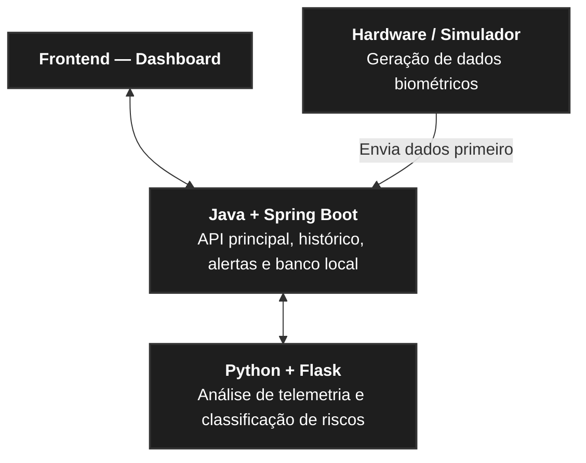

# 🚀 Rapadura Côsmica — NASA Space Apps Challenge 2026

> **Local Event:** Campina Grande, Paraíba, Brazil


> **Challenge:** [Create Health Monitoring Software for Astronauts on Space Missions](https://www.spaceappschallenge.org/2026/challenges/health-monitoring-software/)

---

## 🌌 Sobre o Projeto

Somos a **Rapadura Côsmica**, uma equipe de estudantes de Ciência da Computação, Engenharia da Computação e Análise e Desenvolvimento de Sistemas de Campina Grande (PB). Assim como a rapadura — resistente, energética e essencial no sertão —, construímos uma arquitetura resiliente para apoiar astronautas em missões de longa duração.

Em missões espaciais profundas, a comunicação com a Terra sofre atrasos significativos, exigindo que a tripulação monitore e avalie sua própria saúde de forma autônoma. Nossa solução integra **telemetria de hardware/simulação**, **análise inteligente de anomalias** e um **painel operacional de controle** para identificar riscos precoces (como exposição à radiação, fadiga cardiovascular e perda óssea) e recomendar contramedidas imediatas.

---

## 🏗️ Arquitetura do Sistema

O projeto segue uma arquitetura distribuída em microsserviços desacoplados, comunicando-se via **REST / JSON**:



## 📦 Repositórios da Organização
O código-fonte está dividido por responsabilidade técnica para permitir desenvolvimento paralelo sem gargalos:

| Repositório | Stack Principal | Responsabilidade |
|----------|---------|----------|
| telemetry-edge-engine | Python, Flask, PySerial | Coleta de sensores físicos (ESP32/Arduino) ou simulação biométrica espacial, detecção de anomalias e envio de pacotes JSON. |
| astronaut-health-api | Java, Spring Boot, H2 Database | API REST central, persistência do histórico clínico em memória, motor de triagem de risco e disparo de alertas. |
| mission-control-ui | HTML5, CSS3 (Tailwind), JavaScript | Dashboard em tempo real da cápsula espacial para visualização de sinais vitais, níveis de alerta e protocolos de ação. |

## 🔌 Contrato de Integração (JSON)
Para manter todas as frentes sincronizadas, a comunicação entre o Edge Engine (Python), a Core API (Java) e o Dashboard (UI) segue o padrão:

```json
{
  "astronautId": "ASTRO-01",
  "timestamp": "2026-11-14T15:30:00Z",
  "heartRate": 118,
  "spo2": 96,
  "radiationDoseMsv": 1.4,
  "sleepHours": 5.2,
  "riskLevel": "WARNING",
  "alertMessage": "Frequência cardíaca elevada detectada. Recomenda-se hidratação e repouso."
}
```

## 👨‍🚀 Equipe Rapadura Côsmica
* **Core API & Persistência (Java / Spring Boot):** [Mateus Queiroz](https://github.com/tue1093) & [Grimaldo Júnior](https://github.com/grimaldojunior0413-cloud)
* **Edge, Hardware & Análise de Anomalias (Python / Flask):** [Murilo Costa](https://github.com/MuriloDev07) & [Gabriel Guedes](https://github.com/usuario-pendente-para-colocar)
* **Interface & Experiência do Astronauta (Front-end):** [Cauã Max](https://github.com/pl4utus)
* **Pesquisa Científica NASA, Documentação & Pitch:** [Davi Duclerc](https://github.com/daviduclerc)
---
Desenvolvido com energia nordestina durante o NASA International Space Apps Challenge 2026.

