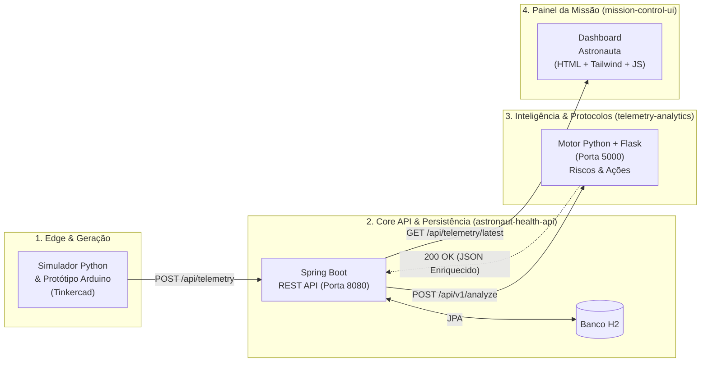

# 🚀 Rapadura Côsmica — NASA Space Apps Challenge 2026

> **Local Event:** Campina Grande, Paraíba, Brazil


> **Challenge:** [Create Health Monitoring Software for Astronauts on Space Missions](https://www.spaceappschallenge.org/2026/challenges/health-monitoring-software/)

---

## 🌌 Sobre o Projeto

Somos a **Rapadura Côsmica**, uma equipe de estudantes de Ciência da Computação, Engenharia da Computação e Análise e Desenvolvimento de Sistemas de Campina Grande (PB). Assim como a rapadura — resistente, energética e essencial no sertão —, construímos uma arquitetura resiliente para apoiar astronautas em missões de longa duração.

Em missões espaciais profundas, a comunicação com a Terra sofre atrasos significativos, exigindo que a tripulação monitore e avalie sua própria saúde de forma autônoma. Nossa solução integra **telemetria de hardware/simulação**, **análise inteligente de anomalias com protocolos de ação imediatos** e um **painel operacional de controle** para identificar riscos precoces (como exposição à radiação, hipóxia e fadiga cardiovascular) e orientar contramedidas em tempo real.

---

## 🏗️ Arquitetura do Sistema

O projeto segue uma arquitetura distribuída em microsserviços desacoplados, comunicando-se via **REST / JSON**:



## 📦 Repositórios da Organização

O código-fonte está dividido por responsabilidade técnica para permitir desenvolvimento paralelo sem gargalos:

| Repositório | Stack Principal | Responsabilidade |
| :--- | :--- | :--- |
| **[astronaut-health-api](https://github.com/rapadura-cosmica-nasa/astronaut-health-api)** | Java, Spring Boot, H2 | API REST central que recebe os dados do simulador, orquestra a análise clínica, persiste o histórico e despacha alertas ao painel. |
| **[telemetry-analytics](https://github.com/rapadura-cosmica-nasa/telemetry-analytics)** | Python, Flask, Marshmallow, Pytest | Simulador interativo de telemetria e Motor Clínico responsável por validar biomarcadores, classificar riscos (`NOMINAL`, `WARNING`, `CRITICAL`) e emitir protocolos operacionais (`recommendedAction`). |
| **[mission-control-ui](https://github.com/rapadura-cosmica-nasa/mission-control-ui)** | HTML5, Tailwind, JS | Dashboard em tempo real para visualização de sinais vitais, níveis de alerta e diretrizes de ação da tripulação. |

## 🔌 Contrato de Integração (JSON)

Para manter todas as frentes sincronizadas, a comunicação segue dois formatos ao longo do fluxo:

### 1. Ingestão de Dados Brutos (Simulador ➔ Core API Java)
Payload enviado pelo Simulador/Hardware com as métricas biométricas coletadas em UTC (ISO 8601):

```json
{
  "astronautId": "ASTRO-01",
  "timestamp": "2026-11-14T15:30:00Z",
  "heartRate": 115,
  "spo2": 92,
  "radiationDoseMsv": 1.4,
  "sleepHours": 5.2
}
```

### 2. Telemetria Classificada e Protocolo de Ação (Análise Python ➔ Java ➔ Dashboard)
Payload enriquecido retornado pelo motor Python após o processamento de regras individuais, correlação cruzada e hierarquia de ação recomendada:

```json
{
  "astronautId": "ASTRO-01",
  "timestamp": "2026-11-14T15:30:00Z",
  "heartRate": 115,
  "spo2": 92,
  "radiationDoseMsv": 1.4,
  "sleepHours": 5.2,
  "riskLevel": "CRITICAL",
  "alertMessage": "Frequência cardíaca elevada/baixa detectada. | Saturação de oxigênio em alerta (90% - 94%). Monitorar respiração. | Atividade solar elevada (0.5 - 2.0 mSv). | Fadiga moderada por baixa duração de sono (5.0h - 6.9h). | Alerta cruzado: Estresse cardiorrespiratório agudo (taquicardia com queda de oxigenação).",
  "recommendedAction": "Abortar atividade extraveicular (EVA), iniciar oxigenoterapia suplementar imediata e acionar médico de voo."
}
```

## 👨‍🚀 Equipe Rapadura Côsmica

* **Core API & Persistência (Java / Spring Boot):** [Mateus Queiroz](https://github.com/tue1093) & [Grimaldo Júnior](https://github.com/grimaldojunior0413-cloud)
* **Edge, Simulação & Análise de Anomalias (Python / Flask):** [Murilo Costa](https://github.com/MuriloDev07) & [Gabriel Guedes](https://github.com/gueeds)
* **Interface & Experiência do Astronauta (Front-end):** [Cauã Max](https://github.com/pl4utus)
* **Pesquisa Científica NASA, Documentação & Pitch:** [Davi Duclerc](https://github.com/daviduclerc)

---
Desenvolvido com energia nordestina durante o NASA International Space Apps Challenge 2026.
